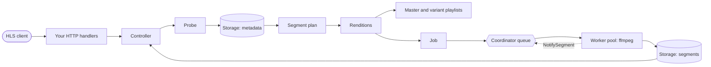

# Architecture

## Pipeline

| Stage | What happens |
|---|---|
| Probe | ffprobe and container indexes yield duration, keyframes, streams and stream ends. The result is stored under the media key. |
| Segment plan | Keyframes and `TargetDuration` produce segments of at most `max(2 x TargetDuration, 12 s)`. A long gap is split. A short tail merges into the previous segment. |
| Renditions | The source resolution and bitrate give a video ladder. Each source audio track gives an audio rendition. Each video rung is copied (`DirectStream`) or transcoded. |
| Jobs | A request for one segment becomes a batch of up to `SegmentsPerJob` segments, trimmed at segments already stored. The batch is a `Job` with a deterministic ID and a digest. |
| Workers | Video and audio pools subscribe to the coordinator by stream type and pipeline profile. A worker verifies the job, runs ffmpeg and validates the output against the planned segment times. |
| Storage | The worker writes segments through `Storage` and publishes readiness through `NotifySegment`. |
| Playlists | Master, variant and subtitle playlists are rendered from metadata and the plan. `PathGenerator` supplies the embedded URLs. |

Segments are transcoded on demand. Playback starts after the first requested segment. Sprites, previews, thumbnails and subtitles are generated on first request and stored.

## Identity

Every stored object lives under a media key. The key hashes the schema, source URL, source revision and pipeline profile. Replicas with equal options and the same ffmpeg build compute equal keys and share the cache. See [operations.md](operations.md#cache-identity-and-schema).

## Coordination across replicas

Three mechanisms keep replicas from duplicating work.

### Flights

A flight is a replica-local record of a batch in progress. It is keyed by the deterministic job ID, a hash of media key, rendition, stream type and segment range.

- A request whose segment falls inside a live flight joins it and waits.
- A new flight ends before the start of the next live flight of the same rendition, so batches do not overlap.
- A flight expires `StartBy` + `JobTimeout` after creation.
- A joining request emits `EventJobJoined`.

### Locks

The batch lock lives in the `Coordinator` and is shared by all replicas.

1. The requesting replica calls `AcquireJob` with the job ID and a new run ID.
2. On success it builds the job, calls `Enqueue` and waits.
3. On `ErrLockHeld` another replica owns the batch. The request calls `WaitJob` on the returned active run ID and `WaitSegment` on the segment, and emits `EventLockWait`.
4. If the lock frees without the segment appearing, the request starts a new flight. A bounded number of retries follows.

The lock TTL is `StartBy` + `JobTimeout` + 1 minute. A replica releases it with `ReleaseJob` once the run reaches a terminal state. Metadata probes and generated assets use named locks (`AcquireLock`) in the same way.

### Jobs

The coordinator moves one job to exactly one worker whose stream type and profile match.

1. The worker receives a `JobDelivery` with a receipt and keeps the lease alive with `Renew`.
2. It checks the digest and `StartBy`, runs ffmpeg and writes each segment.
3. `NotifySegment` wakes waiting requests on any replica.
4. `SettleJob` stores the terminal status for the run. Every replica waiting on the run ID sees it through `WaitJob`.

If a worker dies, its lease expires and the coordinator redelivers the job to another worker. Requests also poll storage with a backoff from 100 ms to 1 s, so a missed notification does not stall a request.

### Waiting and timeouts

A `Segment` call waits up to `SegmentTimeout`. A waiter that leaves does not cancel the job. Another request or replica may need the batch.

`Stop` cancels local detached work and releases the locks of flights that were never enqueued. Locks of enqueued jobs expire by their TTL.
